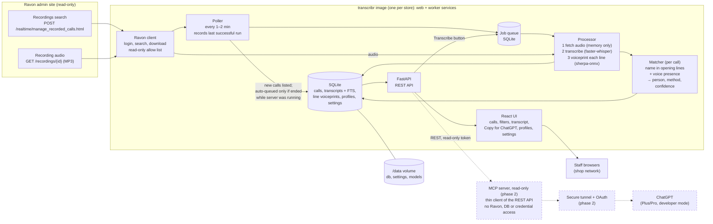

# Transcribr v2 architecture (draft)

Status: approved 2026-10-22. Implemented through three OpenSpec changes in order: `add-call-transcription-core`, `add-call-browser`, `add-call-attribution` (then `add-mcp-server`). Each change's `design.md` holds its decisions; keep this overview in sync with them.

## Block diagram

## Components

| Component | Job |
|---|---|
| Ravon client | Logs in, searches recordings, downloads MP3s into memory. Every request passes a read-only allow list. |
| Poller | Searches recent calls every 1–2 minutes and lists new ones. Auto-queues a call only if it ended while the server was running; calls missed while it was off are listed as "Not transcribed". |
| Job queue | SQLite table; survives restarts. Sources: auto (poller) and the Transcribe button. Retries with backoff, then Failed with a reason. |
| Processor | One job at a time: fetch audio, transcribe into timestamped lines, compute a voiceprint for each line of 1 second or more, discard audio. Lines are not assigned to speakers. |
| Matcher | Assigns a call to a profile by name in the opening lines and/or voice presence (enough seconds of the call's lines matching the profile's voice). It never says who said which line. Stores person, method and confidence; uncertain calls are "Maybe". |
| SQLite | All state: calls (every listed call), transcripts with full-text search, line voiceprints, profiles, settings. |
| FastAPI + React UI | One open view of all calls with per-profile, Unassigned and Maybe filters; transcript view with Copy for ChatGPT; profile setup; settings. |
| MCP server (phase 2) | A separate, thin client of the transcribr REST API, like the UI. Exposes read-only tools and has no access to Ravon, the database or credentials. Only transcribr talks to Ravon. Reached by ChatGPT through a secure tunnel with OAuth. |

## Decisions so far

- Fresh rewrite; v1 (`../transcribr_old`) is used only for verified facts about Ravon and the audio.
- Server on a shop PC; one Docker image (multi-stage build: React built by Node, served by the Python app) run as two compose services, `web` (API + UI) and `worker` (poller + pipeline), sharing one named data volume. See the OpenSpec change design D1. Deployable on Linux, Windows (Docker Desktop/WSL2) or macOS, amd64 or arm64.
- Ravon's user/extension filters do not identify the service writer; attribution comes from the transcript (name) and voiceprints.
- People are configured per instance in the UI, never hard-coded.
- Everyone on the shop network sees all calls and can use every call action without logging in; profiles are filters. People and Settings are in an admin area at `/admin`, behind one admin login created on the first visit with a setup code from the server log. Attribution is stored as data so access can be made stricter later.
- Research happens in the service writer's own ChatGPT: Copy for ChatGPT in phase 1, and in phase 2 a read-only MCP connector to transcribr. ChatGPT asks transcribr for transcripts (ChatGPT → MCP server → transcribr API → transcribr's database). LLMs never talk to Ravon; only transcribr does.
- Audio is not stored; it is fetched from Ravon when needed.

## UI mockups

Draft screens (Calls, Call detail, People, Settings), built from MUI components with the Ubuntu colour palette (https://design.ubuntu.com/brand/colour-palette), with example data only: https://claude.ai/artifact/7fqcHxPP9BuRzd4DkJ6qys

Theme used in the mockups (to become `frontend/src/theme.ts`). Only palette colours and their listed tints are used, plus MUI's semantic success/error/info/warning colours for states:

| Token | Value |
|---|---|
| App bar | Dark aubergine `#2C001E`; inactive tab text dark aubergine 25% `#CABFC6` |
| primary.main / primary.dark | Light aubergine `#77216F` / mid aubergine `#5E2750` (links, selected items, outlined and contained buttons, sliders) |
| secondary.main | Ubuntu orange `#E95420` (Copy for ChatGPT, tab indicator, "Maybe" band), always with `#111111` text: white on orange is only ~3.4:1 |
| background.default / paper | Warm grey 15% `#F2F1F0` / white |
| text.primary / text.secondary | Text grey `#111111` / dark aubergine 70% `#6B4C61`; snackbar ground cool grey `#333333` |
| dividers, neutral chips | Warm grey 25% `#EAE9E7` |
| selected list item | `rgba(119,33,111,0.10)` (light aubergine at 10%) |
| attribution chips | Confident: light aubergine 10% `#F1E8F0` with `#5E2750` text; Maybe: orange 10% `#FDEEE9`, dashed `#E95420` border, `#111111` text |
| search highlight | Orange 30% `#F8CCBC` |
| shape.borderRadius | 10 |
| typography | Roboto (body), Barlow Semi Condensed 600 (headings), Roboto Mono (times, lengths) |
| buttons | `textTransform: none`, weight 500 |

### Dark theme (planned, no mockup yet)

Same palette, same components. It follows the device setting by default, with a Light / Dark / System menu in the app bar saved per browser. The roles stay the same as in light mode; only the values change. Every text/background pair below was checked at 4.5:1 or higher (ratios in brackets).

| Token | Value |
|---|---|
| background.default / paper | Text grey `#111111` / cool grey `#333333` |
| App bar | Dark aubergine `#2C001E` (as in light), white text (18.7), inactive tabs `#CABFC6` (10.5), orange `#E95420` indicator |
| text.primary / text.secondary | White (12.6 on paper) / warm grey `#AEA79F` (5.3 on paper, 7.9 on background) |
| primary.main | Light aubergine 40% `#C8A6C5` (5.9 as text on paper); contained buttons use it as fill with `#111111` labels (8.7) |
| secondary.main | Ubuntu orange `#E95420` for fills, with `#111111` labels (5.2); orange text and icons use orange 60% `#F29879` (5.7) |
| dividers | Warm grey at 24% opacity, `rgba(174,167,159,0.24)` |
| selected list item | `rgba(200,166,197,0.16)` with `#C8A6C5` text |
| attribution chips | Confident: mid aubergine `#5E2750` fill, white text (11.2); Maybe: dashed `#F29879` border, orange 20% `#FBDDD2` text (9.9) |
| search highlight | Orange 50% `#F4AA90` with `#111111` text (9.9) |
| snackbar | Inverted: warm grey 15% `#F2F1F0` ground, `#111111` text (16.7), action in light aubergine `#77216F` (8.3) |
| semantic states | MUI's dark-mode success, error, info and warning colours |
